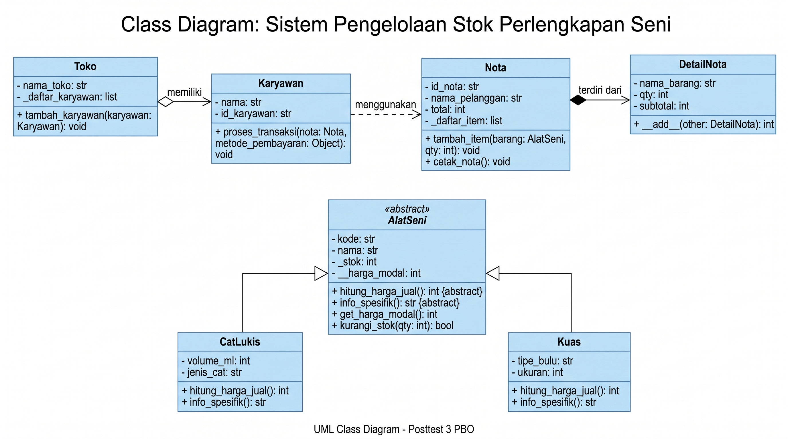
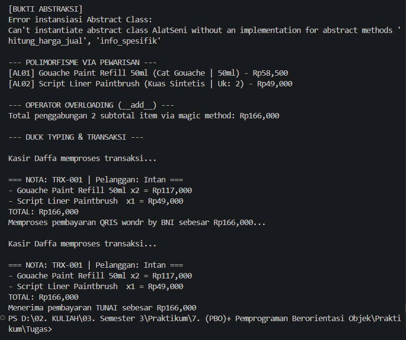

# Laporan Posttest Praktikum PBO 3 (Abstraksi & Polimorfisme)

**Nama:** Nur Fitri Ramadhani  
**NIM:** 2509106089  
**Kelas:** Informatika B'25  
**Tema:** Sistem Pengelolaan Stok Perlengkapan Seni Rupa Terapan di Toko Alat Tulis  

---

## 1. Relasi UML (Class Diagram)
**

**Penjelasan Relasi:**
*   **Asosiasi (Karyawan -> Nota & Pembayaran):** Class `Karyawan` menggunakan objek `Nota` dan kelas metode pembayaran hanya sebagai parameter sesaat saat menjalankan method `proses_transaksi()`, tanpa ada kepemilikan permanen.
*   **Agregasi (Toko o-- Karyawan):** Class `Toko` memiliki penampung untuk mengumpulkan banyak data `Karyawan`. Relasi ini dipilih karena jika entitas Toko dibubarkan atau dihapus dari memori, objek Karyawan tetap ada dan bisa bekerja di tempat lain.
*   **Komposisi (Nota *-- DetailNota):** Class `Nota` terdiri dari baris-baris `DetailNota` yang dirakit langsung dari dalam method `tambah_item()`. Relasi ini dipilih karena rincian pesanan (DetailNota) tidak memiliki arti dan akan ikut hancur secara mutlak jika objek Nota utamanya dibatalkan/dihapus.

## 2. Penerapan Abstraksi
Sistem mengimplementasikan modul `abc` pada superclass **`AlatSeni`**, menjadikannya Abstract Base Class.
*   **Abstract Method:** Terdapat dua method kosong wajib, yaitu `@abstractmethod hitung_harga_jual()` dan `@abstractmethod info_spesifik()`. Keduanya wajib diimplementasikan (di-override) oleh subclass turunan.
*   **Method Konkret:** `AlatSeni` memiliki method `kurangi_stok(qty)` yang isinya logika operasional penuh dan langsung dipakai bersama oleh semua turunannya tanpa perlu ditulis ulang.
*   **Bukti:** Jika class `AlatSeni` dipaksa untuk diinstansiasi secara langsung, terminal akan memunculkan *TypeError* yang sengaja ditangkap menggunakan blok `try-except` di awal jalannya program.

## 3. Penerapan Polimorfisme
*   **Polimorfisme via Pewarisan:** Subclass `CatLukis` dan `Kuas` masing-masing meng-override method `hitung_harga_jual` (memberikan margin keuntungan 30% untuk cat, dan 40% untuk kuas) serta meng-override magic method `__str__`. Keduanya dipanggil berurutan melalui satu perulangan `for` sederhana tanpa pengecekan tipe data (`type()`).
*   **Duck Typing:** Terdapat dua class independen yang tidak saling mewarisi, yaitu `PembayaranTunai` dan `PembayaranQRIS`. Keduanya memiliki fungsi bernama sama, yakni `proses_bayar()`. Fungsi global `eksekusi_pembayaran` dapat menerima objek dari class manapun dan mengeksekusinya tanpa mempedulikan jenis class-nya, asalkan method tersebut tersedia.
*   **Operator Overloading:** Mengimplementasikan dunder method `__add__` pada class `DetailNota`, memungkinkan program untuk langsung menjumlahkan nominal harga dari dua objek barang menggunakan simbol matematika biasa (`+`).

## 4. Nilai Plus: Penerapan Prinsip SOLID
Program ini menerapkan **Open/Closed Principle (OCP)** dari konsep SOLID pada sistem transaksinya. 
Fungsi `eksekusi_pembayaran()` dan method `proses_transaksi()` milik Karyawan dibuat tertutup dari modifikasi, namun sangat terbuka untuk ekstensi. Jika toko ingin menambahkan metode pembayaran baru (misalnya `PembayaranTransferBank` atau `PembayaranKredit`), kita cukup membuat class baru dengan method `proses_bayar()` di dalamnya, tanpa perlu merombak atau menambahkan rantai `if/elif` panjang pada kode fungsi eksekusi utama.

## 5. Output Eksekusi Terminal
**